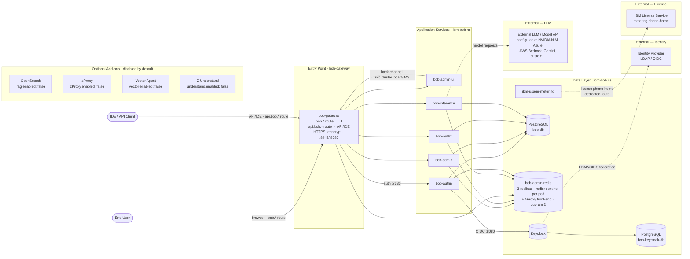
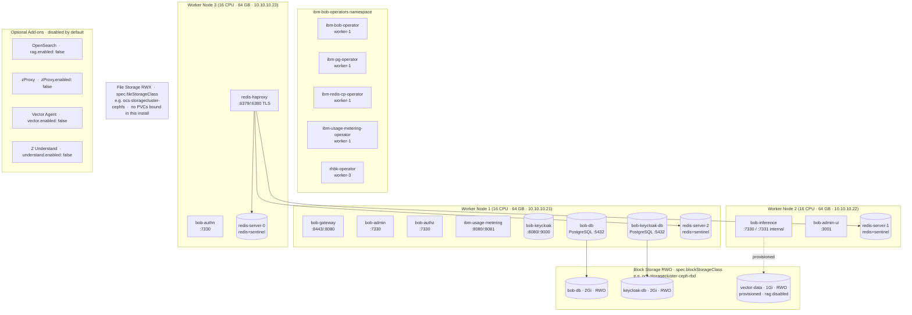

# IBM Bob — Deployment Architecture

**Cluster:** itz-sxd5vd  
**Updated:** 2026-09-24  
**OpenShift:** 3 control plane nodes · 3 worker nodes · cert-manager (Red Hat Operator)

> **Note:** RAG (OpenSearch), Vector agent, zProxy, and Z Understand are all
> **disabled by default** in this installation. They are shown in diagrams with
> dashed borders / greyed styling. Enable each via the corresponding Bob CR field.

---

## Diagram 1 — Request Flow (logical)

## Diagram 2 — Node & Storage Placement (infrastructure)

---

## Component Summary

| Component | Pod | Namespace | Node | Role |
|---|---|---|---|---|
| API Gateway | bob-gateway | ibm-bob | worker-1 | Routes all client requests · serves both UI and API routes |
| Application | bob-admin | ibm-bob | worker-1 | Admin interface backend |
| Application | bob-admin-ui | ibm-bob | worker-2 | Browser UI · calls gateway via svc.cluster.local:8443 |
| Auth | bob-authn | ibm-bob | worker-3 | Authentication (Keycloak OIDC) |
| Auth | bob-authz | ibm-bob | worker-1 | Authorization (policy enforcement) |
| Inference | bob-inference | ibm-bob | worker-2 | LLM request handling · model gateway |
| Identity | bob-keycloak | ibm-bob | worker-1 | OIDC / SSO — StatefulSet 1/1 |
| Database | bob-db (PostgreSQL) | ibm-bob | worker-1 | Primary app data store · ibm-pg-operator |
| Database | bob-keycloak-db (PostgreSQL) | ibm-bob | worker-1 | Keycloak-dedicated store · ibm-pg-operator |
| Cache | redis-server-0/1/2 | ibm-bob | worker-3/2/1 | Session & object cache · redis+sentinel per pod |
| Cache proxy | redis-haproxy | ibm-bob | worker-3 | HAProxy front-end to Redis cluster · :6379/:6380 TLS |
| Metering | ibm-usage-metering | ibm-bob | worker-1 | IBM license usage tracking · dedicated external route |
| Operator | ibm-bob-operator | ibm-bob-operators | worker-1 | Reconciles Bob CR |
| Operator | ibm-pg-operator | ibm-bob-operators | worker-1 | Manages PostgreSQL StatefulSets |
| Operator | ibm-redis-cp-operator | ibm-bob-operators | worker-1 | Manages Redis cluster |
| Operator | ibm-usage-metering-operator | ibm-bob-operators | worker-1 | Manages metering instance |
| Operator | rhbk-operator | ibm-bob-operators | worker-3 | Manages Keycloak StatefulSet |

## Routes (External Ingress)

| Route | Host | TLS Mode | Target |
|---|---|---|---|
| `bob-gateway` (UI) | `bob.ibm-bob.apps.<cluster>` | reencrypt | bob-gateway :8443 |
| `bob-gateway` (API) | `api.bob.ibm-bob.apps.<cluster>` | reencrypt | bob-gateway :8443 |
| `bob-keycloak-ingress` | `bob-keycloak.ibm-bob.apps.<cluster>` | edge | bob-keycloak-service :8080 |
| `ibm-usage-metering-fetch` | `ibm-usage-metering-fetch-ibm-bob.apps.<cluster>` | reencrypt | ibm-usage-metering :8080 |

## Storage

| Volume | Size | Access | Used by | Note |
|---|---|---|---|---|
| bob-db-1 | 2 Gi | RWO | PostgreSQL bob-db | `spec.blockStorageClass` (e.g. ocs-storagecluster-ceph-rbd) |
| bob-keycloak-db-1 | 2 Gi | RWO | PostgreSQL bob-keycloak-db | `spec.blockStorageClass` |
| vector-data | 1 Gi | RWO | (reserved) | Provisioned but unused — `rag.enabled: false` |
| _(none bound)_ | — | RWX | — | `spec.fileStorageClass` configured (e.g. ocs-storagecluster-cephfs) — no PVCs bound in this install |

## Optional Add-ons (disabled by default)

| Component | CR field | Purpose | Dependency |
|---|---|---|---|
| OpenSearch | `bob.rag.enabled` | RAG / vector search for code context | Standalone |
| Vector agent | `bob.vector.enabled` | Log collection to IBM COS | — |
| zProxy | `bob.zProxy.enabled` | IBM Z RAG stack | Implies `rag.enabled: true` |
| Z Understand | `bob.understand.enabled` | Mainframe code analysis (requires Db2 or SQL Server) | Standalone |

## Cluster Prerequisites

| Component | Required | Purpose |
|---|---|---|
| cert-manager | Yes (Red Hat Operator) | TLS for all external routes + internal mTLS |
| Helm ≥ 3.14.0 | Yes | `--reset-then-reuse-values` flag support |
| `oc` CLI | Yes | Install and management |
| Block storage (RWO) | Yes | Database PVCs |
| File storage (RWX) | Yes (configured) | Shared volumes — not yet consumed in this install |
