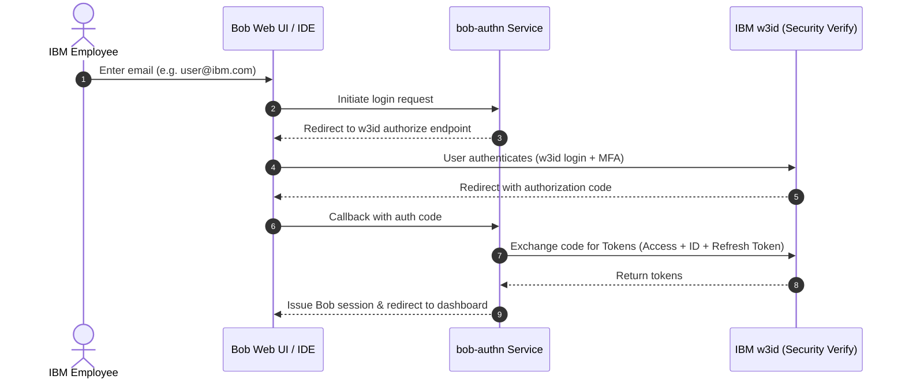

# Configuring IBM w3id OIDC Single Sign-On (SSO) for IBM Bob On-Prem

This guide provides step-by-step instructions for configuring IBM Bob on-premise to authenticate IBM employees using **IBM w3id SSO via OpenID Connect (OIDC)**.

---

## Overview of the Authentication Flow



---

## Prerequisites

1. **Access to IBM SSO Provisioner**: [https://w3.ibm.com/security/sso-provisioner](https://w3.ibm.com/security/sso-provisioner)
2. **Access to IBM Bob Admin Console**: Logged in as a Bob administrator (e.g., `https://bob.<instance-namespace>.apps.<cluster-domain>/admin`).
3. **Bob Tenant Callback URL**: Determine your cluster's Bob API callback URL:
   ```text
   https://api.bob.<instance-namespace>.apps.<cluster-domain>/authn/v1/auth/callback
   ```
   *Example:*
   `https://api.bob.ibm-bob.apps.itz-sxd5vd.infra01-lb.wdc07.techzone.ibm.com/authn/v1/auth/callback`

---

## Part 1: Register Application in IBM SSO Provisioner

### Step 1: Create a New Application
1. Navigate to the [IBM SSO Provisioner](https://w3.ibm.com/security/sso-provisioner).
2. Click **Create Application**.
3. Enter an **Application Name** (e.g., `bob-onprem`) and a **Description**.
4. Save the application.

### Step 2: Create OIDC Configuration
1. Inside your newly created application page, click **Create Configuration**.
2. Select the following settings:
   - **Identity Provider**: `w3id SSO`
   - **SSO Protocol**: `OIDC`
   - **Tenant**: `Production`
3. Click **Next**.
4. Enter a configuration name (e.g., `bob-onprem-oidc`).
5. To generate your cluster's exact Redirect URI, run the following command on your bastion:
   ```bash
   CLUSTER_DOMAIN=$(oc get ingresses.config cluster -o jsonpath='{.spec.domain}')
   echo "https://api.bob.ibm-bob.${CLUSTER_DOMAIN}/authn/v1/auth/callback"
   ```
6. In the **Redirect URIs** field, enter the Bob on-prem tenant callback URL:
   ```text
   https://api.bob.<instance-namespace>.apps.<cluster-domain>/authn/v1/auth/callback
   ```
7. Submit the configuration.

### Step 3: Wait for Activation & Retrieve Credentials
1. The configuration will initially show a **Pending** state.
2. Wait approximately 5–10 minutes and refresh the page until the state changes to **Active**.
3. Once active, copy and save:
   - **Client ID** (e.g., `YWY5JmZkMgjtEmMxSM00`)
   - **Client Secret** (click the copy icon)

### Step 4: Enable Refresh Tokens (Critical Step)
> ⚠️ **CRITICAL REQUIREMENT:**
> `bob-authn` strictly requires a `refresh_token` in the token exchange response to establish user sessions. By default, IBM Security Verify does not issue refresh tokens unless explicitly enabled. Failing to complete this step will result in:
> `token exchange incomplete: no refresh_token in OIDC response: provider may not support offline_access scope`.

1. In the SSO Provisioner, click **Edit** on your active configuration.
2. Under **Options** (or **Token Settings** / **Grant Types**), select the **Generate refresh token** option.
3. Save the updated configuration.

---

## Part 2: Configure OIDC Provider in IBM Bob Admin UI

### Step 1: Open Single Sign-On (SSO) Settings in Bob
1. Open the Bob Admin Console in your browser:
   ```text
   https://bob.<instance-namespace>.apps.<cluster-domain>/admin
   ```
2. In the left navigation menu, navigate to **Single Sign-On (SSO)** (or `/admin/idp`).
3. Click the **Add IDP** button on the top right.
4. Select **OIDC configuration**.

---

### Step 2: Wizard Step 1 — Basics
1. **Provider name**: `IBM w3id`
2. **Description (Optional)**: `IBM w3id SSO for IBM employees`
3. Click **Continue**.

---

### Step 3: Wizard Step 2 — OIDC Configuration
1. In the **Issuer URL or discovery document URL (Optional)** field, enter:
   ```text
   https://login.w3.ibm.com/oidc/endpoint/default
   ```
   > ⚠️ **Discovery URL Warning:**
   > Ensure the domain is **`login.w3.ibm.com`**, NOT `login.ibm.com`. Client registrations created via the internal SSO Provisioner exist in the `login.w3.ibm.com` production tenant.
2. Click **Retrieve configuration**.
   - Bob will automatically query the discovery endpoint and auto-fill the following fields:
     - **Authorization endpoint**: `https://login.w3.ibm.com/v1.0/endpoint/default/authorize`
     - **Token endpoint**: `https://login.w3.ibm.com/v1.0/endpoint/default/token`
     - **UserInfo endpoint**: `https://login.w3.ibm.com/v1.0/endpoint/default/userinfo`
     - **Issuer**: `https://login.w3.ibm.com/oidc/endpoint/default`
     - **JWKS URI**: `https://login.w3.ibm.com/v1.0/endpoint/default/jwks`
3. Enter your client credentials retrieved from Part 1:
   - **Client ID**: Paste your Client ID (e.g., `YWY4ZmJkMjgtMmExMS00`)
   - **Client Secret**: Paste your Client Secret (revealed from SSO Provisioner)
4. Ensure the **Scopes** field includes:
   ```text
   openid email offline_access
   ```
   *(Ensure `offline_access` is kept as a badge to match the refresh token requirement).*
5. Click **Continue**.

---

### Step 4: Wizard Step 3 — Review & Save
1. Review the configuration summary.
2. Click **Save** / **Done**.

---

## Part 3: Register and Verify Email Domains

After saving your IdP configuration, you must register and verify the corporate email domains (e.g., `ibm.com`, `us.ibm.com`) so Bob knows to route users with those email suffixes to this IdP.

### Step 1: Add Domains in Bob Admin UI
1. In the Bob Admin Console, return to the **Single Sign-On (SSO)** page (`/admin/idp`).
2. Find your IdP (e.g. `IBM w3id` or `ibm_bob_on_premises`) and click the **⋮ (three dots) → Manage domains** action.
3. Add each email domain your users will log in with:
   - `ibm.com`
   - `us.ibm.com`
4. The added domains will appear with a yellow **Pending** status. This is expected because the UI defaults to requiring a public DNS TXT record check.

### Step 2: Mark Domains as Verified (Admin SQL Bypass)
Because this is an on-prem deployment, you as the cluster administrator assert domain ownership by updating the rows directly in the Bob PostgreSQL database. This is safe, intentional, and bypasses the external DNS TXT check.

Run the following command on your bastion/terminal:

```bash
NAMESPACE="ibm-bob"
DB_PASS=$(oc get secret bob-db-app -n "$NAMESPACE" -o jsonpath='{.data.password}' | base64 -d)

oc exec -n "$NAMESPACE" bob-db-1 -- bash -c "
  PGPASSWORD='${DB_PASS}' psql -h bob-db-rw -p 5432 -U bob -d bob -c \"
    UPDATE idp_domains
    SET verified = true,
        verified_at = now(),
        updated_at = now()
    WHERE verified = false;
  \"
"
```

Expected output: `UPDATE 2` (or the number of domains you added).

You can confirm the verified status with:
```bash
oc exec -n "$NAMESPACE" bob-db-1 -- bash -c "
  PGPASSWORD='${DB_PASS}' psql -h bob-db-rw -p 5432 -U bob -d bob \
  -c 'SELECT domain_suffix, verified, verified_at FROM idp_domains;'
"
```

The Bob Admin UI will now display green **Verified** badges for those domains.

---

## Part 4: Verification & Troubleshooting

### 1. Test the Login Flow
1. Open a new private/incognito browser window.
2. Go to the Bob Web UI URL:
   ```text
   https://bob.<instance-namespace>.apps.<cluster-domain>/
   ```
3. Enter your IBM email address (e.g. `user@ibm.com` or `user@us.ibm.com`).
4. Click **Log In** — you should be redirected to the IBM w3id login page.
5. Complete 2FA. Upon successful authentication, you should be redirected to the Bob Dashboard.

---

### 2. Common Errors and Resolutions

| Symptom / Log Error | Cause | Resolution |
|---|---|---|
| `CSIAQ0154E` (Client does not exist) | The discovery endpoint was set to `login.ibm.com` instead of `login.w3.ibm.com`. | Update the Issuer URL in the Bob Admin UI to `https://login.w3.ibm.com/oidc/endpoint/default`. |
| `token exchange incomplete: no refresh_token in OIDC response: provider may not support offline_access scope` | The **Generate refresh token** option was not enabled in IBM SSO Provisioner. | Edit the configuration in [IBM SSO Provisioner](https://w3.ibm.com/security/sso-provisioner), check **Generate refresh token**, and ensure `offline_access` is in Bob's Scopes. |
| `redirect_uri_mismatch` / Invalid Redirect URI | The callback URL registered in SSO Provisioner does not match Bob's tenant API URL. | Verify the callback URL in SSO Provisioner matches `https://api.bob.<instance-namespace>.apps.<cluster-domain>/authn/v1/auth/callback`. |

---

### 3. Checking Authn Service Logs
To inspect live authentication logs on your cluster:
```bash
oc logs -n ibm-bob deployment/bob-authn --tail=50 -f
```
A successful authentication flow will log:
```json
{"level":"info","msg":"Selected IDP for authentication","idp_type":"oidc"}
{"level":"info","msg":"OAuth callback received"}
{"level":"info","msg":"Bob-AuthZ permissions retrieved"}
{"level":"info","msg":"Authentication successful"}
{"level":"info","msg":"BFF mode: redirecting with code"}
```
